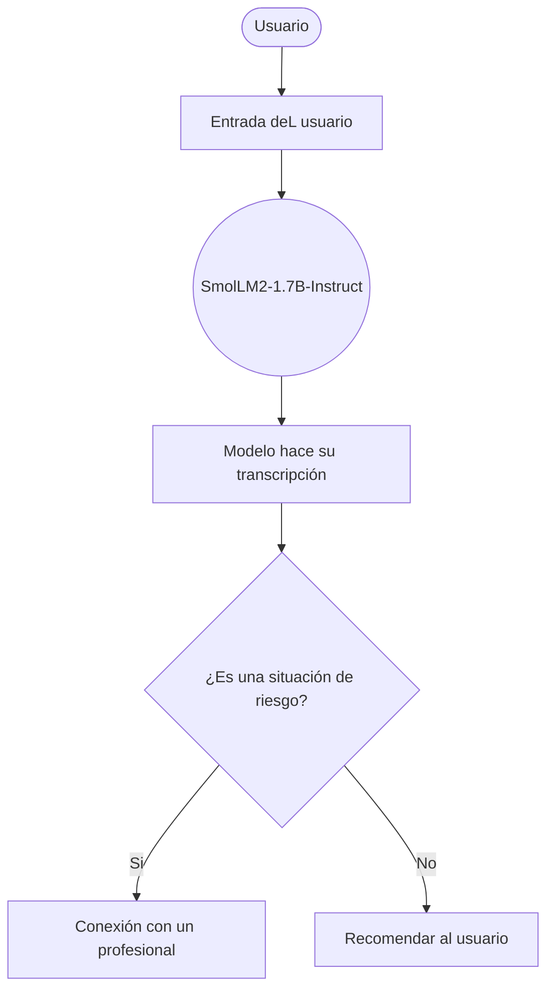
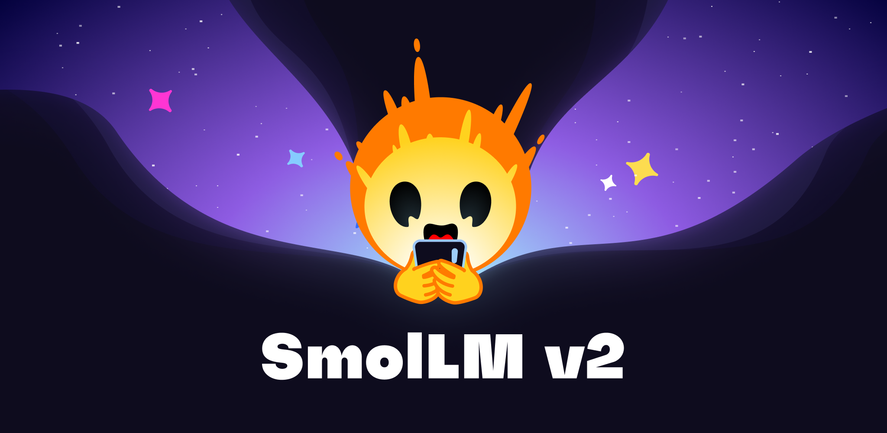

# Asistente Emocional Universitario

  

> Resolvemos la falta de acceso inmediato a herramientas de autorreflexión y detección temprana de crisis emocionales para jóvenes universitarios con altos niveles de estrés.

  

**Proyecto integrador · Herramientas de IA**

  

**Grupo:** A1 · **Equipo:** 3

  

## 👥 Integrantes

  
| Nombre                     |
| :------------------------- |
| José Arturo Amaro Casillas |
| Paola Romina Meza Lopez    |
| Fernanda Montes Negrete    |
| Ian Alejandro Maciel Romo  |

## 1. Caso de uso

  

La falta de acceso inmediato a herramientas de autorreflexión y detección temprana de crisis emocionales para jóvenes universitarios con altos niveles de estrés.

  

- **Entrada:** Siento que por más que estudio y me desvelo para los exámenes, no importa lo que haga, siempre voy a reprobar todo. Ya ni vale la pena seguir intentándolo.

- **Salida:** Lo siento, tú estas enfocado en la evaluación de los exámenes y no puedes superarlo, eso puede causar sentirse frutado o desentendido. Tome un momento para tomar un vistazo y verificar los pasos que deberías hacer para asegúrate de que estas enfocado en todo el proceso. Te recomendaría hacer un pequeño planificador para alinearte con los objetivos y las rutinas de tu asistencia emocional.

## 🔀 Cómo funciona

## 2. Modelo abierto elegido

  

| Dato                         | Respuesta                                                                                                                                                                                                                                |
| ---------------------------- | ---------------------------------------------------------------------------------------------------------------------------------------------------------------------------------------------------------------------------------------- |
| Identificador                | [HuggingFaceTB/SmolLM2-1.7B-Instruct](https://huggingface.co/HuggingFaceTB/SmolLM2-1.7B-Instruct)                                                                                                                                        |
| Tarea (pipeline tag)         | `text-generation`                                                                                                                                                                                                                        |
| Número de parámetros         | 1.71 mil millones (1.7B)                                                                                                                                                                                                                 |
| Licencia                     | Apache 2.0                                                                                                                                                                                                                               |
| Limitación o sesgo declarado | Sus autores declaran que, debido a los datos de entrenamiento del contenido web, el modelo puede generar respuestas sesgadas o no óptimas en temas sensibles, y no debe utilizarse como sustituto de asesoramiento médico o profesional. |

  

## 3. Viabilidad de hardware

  

$$

\text{Memoria mínima} = N \times 2\ \text{bytes} \approx \ ?\ \text{GB}

$$

  

- **VRAM disponible en Colab:** FP16 es de ≈3.4 GB (GPU T4)

- **Dónde se ejecuta:** Google Colab

- **Por qué:**  Ofrece 15 GB de VRAM, cubriendo holgadamente el peso del modelo y los kv-cache durante la inferencia. Se ejecutará directamente en Google Colab con GPU T4 utilizando la librería transformers, ya que no sobrepasa la memoria disponible y permite ejecutar todo el código de forma gratuita y local dentro del notebook.

  
  

## 4. Riesgo ético

  

- **Riesgo:** Que el modelo genere diagnósticos erróneos o minimice una crisis severa (ej. ideación suicida).

- **Mitigación:** Implementar una regla estricta de palabras clave (hardcoded guardrail) que detecte crisis e interrumpa al modelo para mostrar directamente números de emergencia profesional, junto con una advertencia visible de que el sistema no es un terapeuta humano.

  
  

## 5. Evidencia

